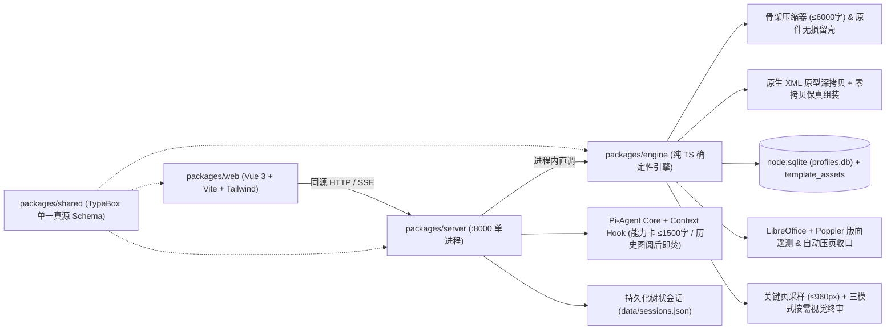

# DocForge V3 · 基于 Pi-Agent 的低成本通用文档格式与排版系统

DocForge V3 采用**全栈 TypeScript Monorepo（单运行时、单进程、单端口）**架构，面向**党政机关与高校红头公文**、**学术学位论文 / 技术规范**、**技术合同协议 / 科研项目申报表**三大高频真实办公场景，提供确定性留壳克隆排版、零拷贝逐字保真套版、Poppler 版面遥测与按需视觉双轨审计，以及渐进式披露双模式前端工作台。系统同时 100% 向下兼容 V2 公文预设库与全部 `9+2` HTTP 接口契约。

## 系统架构



### Monorepo 模块划分

- `packages/shared`（`@docs-agent/shared`）：前后端、Agent 工具与文档引擎共用的 TypeBox Schema 与跨端类型（V2 预设/AST/审计报告 + V3 骨架/蓝图/套版计划/版面遥测/视觉终审/SSE 事件）。
- `packages/engine`（`@docs-agent/engine`）：纯 TypeScript 确定性 OOXML 引擎（`fflate` + `@xmldom/xmldom` + WordprocessingML Schema 顺序插入表 + `node:sqlite` + LibreOffice/Poppler 工具链），运行期零 Python 依赖、零 C++ 原生编译插件。
- `packages/server`（`@docs-agent/server`）：单进程统一 HTTP/SSE 服务，合并 V2 `9+2` 接口、V3 模板与套版接口、`/chat` 流式对话、`/sessions*` 树状分支及 `/` 前端静态托管，工具全部进程内直调引擎。
- `packages/web`（`@docs-agent/web`）：Vue 3 + Vite + TypeScript + Tailwind CSS 构建的「极简瑞士 · 渐进式披露双模式」工作台，生产构建本地打包至 `packages/web/dist/`，零外网运行时 CDN。

## 环境前置与快速启动

### 运行环境要求

- **Node.js** `22.5+`（内置 `node:sqlite`，本机实测 `v26.3.0`）与 `npm`
- **LibreOffice**（提供 `soffice`，用于 `.doc` 二进制 OLE 魔数转换与 PDF 导出）
- **Poppler 工具链**（提供 `pdftoppm`、`pdftohtml`、`pdfinfo`，用于版面几何遥测与 PNG 渲染）

### 安装、构建与一键启动

```bash
cd /home/missi/project/docs-agent
npm install && npm run build
cp .env.example .env  # 若已有 .env 请勿覆盖，按需填入模型配置
./start.sh
```

浏览器访问 **`http://localhost:8000`** 即开即用（`GET /` 同源托管工作台，`Ctrl+C` 停止单进程服务）。若默认 `8000` 端口已被其他服务占用，脚本会自动检测并提示改用指定端口启动：

```bash
PORT=18000 ./start.sh
# 亦向后兼容 V2 环境变量：
ENGINE_PORT=18000 ./start.sh
```

## 核心配置说明（`.env`）

| 环境变量 | 说明 |
|---|---|
| `PORT` / `ENGINE_PORT` | 单进程统一监听端口，默认 `8000` |
| `LLM_BASE_URL` / `LLM_API_KEY` / `LLM_MODEL` | 主对话与骨架内化/段落规划使用的 OpenAI 兼容模型（如 DeepSeek） |
| `LLM_INPUT_USD_PER_MILLION` / `LLM_OUTPUT_USD_PER_MILLION` | 可选，每百万输入/输出 Token 单价（美元），用于实时计算成本账单 |
| `LANGFUSE_PUBLIC_KEY` / `LANGFUSE_SECRET_KEY` / `LANGFUSE_BASE_URL` | 可选，Langfuse v4 OpenTelemetry 链路追踪（覆盖 `/chat` 工具树与独立模型调用；留空自动降级为本地 Pino 日志） |
| `LOG_LEVEL` | 可选，后端 Pino 结构化日志级别（默认 `info`，同时输出至终端与 `data/logs/server.log`） |
| `LLM_SUPPORTS_VISION` | 双轨视觉模式 ①：设为 `true` 时直接使用主模型原生多模态进行关键页终审 |
| `VISION_BASE_URL` / `VISION_API_KEY` / `VISION_MODEL` | 双轨视觉模式 ②：主模型为纯文本模型时，配置廉价多模态侧车模型执行视觉终审 |
| （均未配置视觉参数） | 双轨视觉模式 ③：自动优雅降级为 `text_only`（Poppler 文本版面遥测 + OOXML 独立审计），零报错运行 |

## 工作台双模式与三大文档场景指南

### 渐进式披露双模式界面

- **普通模式（默认开启）**：极简两栏布局。顶栏仅保留格式选择器胶囊与右上角「调试模式」开关；左栏提供「原文字套格式」（粘贴或导入 `.docx/.txt` 草稿，一键零改字套版）与「让 AI 写 / 改」（自然语言起草与改稿）；右栏展示点阵画布上的大尺寸 A4 真实页面预览、翻页与 Word 下载。仅当 Poppler 检出末页 1~3 行溢出或孤立落款时，按需浮现浅琥珀「一键压进整页」温柔建议条，收口后自动隐去。
- **调试模式（右上角开关一键展开）**：无刷新滑出左侧模板资产库与精简能力卡预览（含字数/Token 估算与保留壳清单）、顶栏树状会话分支选择器与实时 Token 账单、中栏零拷贝 `P0..Pn` 段落区间映射表与确定性手术胶囊条，以及右栏缩放控件、三枚技术徽章与底部三标签诊断抽屉（Poppler 页底占空比进度条 / OOXML 审计 / 视觉终审与历史图片阅后即焚计数）。


### 三大高频文档场景使用流程

1. **带红头/五角星/版记的公文**：点击顶栏格式胶囊 → `+ 导入新范例` 上传单位真实 `.doc/.docx` 红头文件（自动识别 OLE 魔数 `D0CF11E0A1B11AE1`），系统经骨架压缩内化并无损保留母版红头、横线、版记与 `22×28` 文档网格；在左栏粘贴通知/纪要正文点击「套用格式」，自动完成三级标题首句加粗与标点规范化。
2. **学术学位论文 / 调研报告**：导入学校官方硕博论文模板（如含校徽图片、10+ 分节与奇偶页眉的 `.docx`），系统原样保留 `word/media/*` 嵌入图片、封面与分节页眉页脚，通过深拷贝原件章节标题、正文、三线表与参考文献悬挂缩进原型组装长文。
3. **技术合同协议 / 项目申报表格**：导入政府或高校标准合同/申报书 `.doc/.docx`，保留封面编号栏、甲乙方信息表与签章区结构，支持编号条款克隆、重点责任句首句加粗下划线及跨页表格遥测预警。

## 统一接口与 Agent 工具参考

### 单端口 HTTP / SSE 路由

- **健康与静态资源**：`GET /health`、`GET /`、`GET /assets/*`、`GET /files/*`
- **V3 模板与通用排版**：
  - `POST /api/v3/templates/inspect`、`POST /api/v3/templates`、`GET /api/v3/templates`、`GET /api/v3/templates/:id`、`PUT /api/v3/templates/active`、`POST /api/v3/templates/:id/fork`、`DELETE /api/v3/templates/:id`
  - `POST /api/v3/drafts/ingest`、`POST /api/v3/documents/compose`、`POST /api/v3/documents/:id/adjust-layout`、`POST /api/v3/documents/:id/visual-audit`
- **Pi-Agent 流式对话与树状会话**：`POST /chat`（SSE）、`GET /sessions`、`POST /sessions/fork`、`POST /sessions/switch`
- **V2 100% 向下兼容接口**：`GET /api/profiles`、`GET /api/profiles/:id`、`POST /api/profiles/extract`、`POST /api/profiles/from-nl`、`POST /api/profiles/:id/fork`、`PUT /api/profiles/active`、`DELETE /api/profiles/:id`、`POST /api/documents/render`、`POST /api/documents/repair`、`POST /api/documents/lint`

### Pi-Agent 工具集

- **V3 7 个通用文档工具**（`packages/server/src/tools_v3.ts`）：`inspect_reference_doc`、`save_template_asset`、`manage_templates`、`ingest_draft`、`compose_document`、`adjust_layout`、`audit_and_inspect`。
- **V2 6 个兼容公文工具**（`packages/server/src/tools_v2.ts`）：`import_doc_format`、`parse_nl_format`、`manage_profiles`、`load_doc_skill`、`render_gongwen_docx`、`lint_and_preview_docx`。

## 构建、测试与评测命令

```bash
npm run typecheck                           # 全 workspace TypeScript 严格类型检查
npm run stylecheck                          # 检查全部 TS/Vue 源码行宽、单行多语句与 4 份文种 Skills
npm run build                               # 类型检查 + 打包前端工作台至 packages/web/dist
npm test                                    # 运行全量 Vitest 回归测试（V2 全量兼容 + V3 全套件）
npx tsx packages/server/tests/e2e_verify_v3.ts   # 运行单进程真实 LLM 端到端验收
npx tsx eval/run_benchmark_v3.ts            # 运行 V3 跨领域 30 份语料与 Token 账单基准评测
```

## 基准评测指标与单文档 Token 账单

完整逐文档原始数据与分项表格详见 [V3 实测报告](eval/report_v3.md)、[V3 原始结果](eval/results_v3.json) 以及 V2 基线历史报告 [eval/report.md](eval/report.md) / [eval/results.json](eval/results.json)。

| 评测维度 | 样本规模 | 实测结果 | 实测关键指标 |
|---|---:|---:|---|
| 跨领域锁定真实语料 SHA256 校验 | 30 份（16 公文 + 4 论文/规范 + 3 申报表 + 7 合同） | **30/30（100.00%）** | 原件零修改通过 |
| 骨架压缩器预算门禁（≤ 6,000 字符） | 30 份（最大原 XML 1,048,222 字符） | **30/30（100.00%）** | 平均骨架 **1,707 字符**，峰值 **5,699 字符**，平均压缩比 **1.77%** |
| 原件无损留壳组装与 PNG 渲染 | 30 份 | **30/30（100.00%）** | `word/media/*`、页眉页脚、分节符与样式表 30/30 字节级一致 |
| 跨领域长草稿零拷贝保真套版（1,500~5,000 字） | 6 份（公文/论文/申报表/合同） | **6/6（逐字保真率 100.00%）** | 真实 DeepSeek 单文档均值：输入 **390** + 输出 **1,499** = **1,889 tokens**（学术/申报书最低 **474~516 tokens**） |
| 真实末页溢出 / 孤立落款自动压页收口 | 6 份真实公文预设溢出样本 | **6/6（警报归零率 100.00%）** | 收口前 10 项警报 → 收口后 **0 项**，6/6 页数成功减 1 |
| 双轨视觉终审与关键页采样（≤ 960px） | 6 份多页/含表真实模板 | **6/6（零报错闭环）** | 实测 `text_only` 优雅降级，每份最多采样 **3 页**，最大宽度 **960px** |
| V2 历史全量兼容基线（合成/真实公文/NL/修复） | 20 合成 + 16 公文 + 30 NL + 10 故障注入 | **100.00% 通过** | 合成提取 2088/2088，NL 233/233，故障修复违规 17 → 0 |

## 已知边界说明

- 本机 Linux 环境未预装商业授权中文字体（如方正小标宋简体、仿宋_GB2312），LibreOffice 生成预览 PNG 时通过系统字体回退渲染；生成的 `.docx` 底层 OOXML `w:rFonts` 四属性与独立审计均严格写入真实目标字体名称，在安装对应字体的桌面 Word 环境中即按标准字形显示。
- `@mariozechner/pi-agent-core` 与 `@mariozechner/pi-ai` 固定采用锁定版本 `^0.73.1`，并通过 `overrides.basic-ftp = "6.2.6"` 消除传递依赖漏洞。
