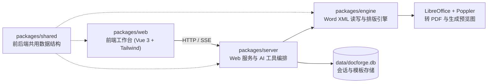

# DocForge · Word 模板套版与 AI 排版工作台

平时写**实验报告、课程设计、毕业论文、红头公文、合同或申报表**时，最烦的往往不是写内容，而是调格式：手里只有学校或单位发的一份 `.doc` / `.docx` 样板文件，里面带着校徽页眉、复杂表格、填空下划线、旧示例文字和一堆红色的“填写说明”。

**DocForge** 用来直接解决这件事——把现成的 Word 样板拖进来学会格式，之后不管是拿现成文章去套格式，还是让 AI 从头写，都能直接导出排好版的 `.docx` 文件。

---

## 它能干什么

- **传一份 Word 就能当模板用**：支持 `.doc` 和 `.docx`。导入时系统会自动在后台试填一遍并转成 PDF 检查效果，把旧示例和填写提示清理干净，只留版式、表头和固定栏目。
- **原件里的页眉、校徽、框表原样保留**：学校 Logo、红头横幅、页眉页脚、合并单元格大表全部无损保留；表头没填的空位会自动清空，不会残留样板里别人的名字和学号。
- **两种用法随时切换，共享同一份底稿**：
  1. **原文字套格式**：把写好的正文贴进左侧编辑器（或上传草稿），一字不改地按模板排好标题、正文和段落缩进；
  2. **让 AI 写 / 改**：在聊天框直接提要求，AI 自动填写表头槽位、起草正文与标准三线表，并实时把内容同步回左侧草稿框。
- **模板不对，直接在聊天里让 AI 修**：如果导进来的模板本身有毛病（比如正文莫名带了下划线和加粗、缺少小标题样式、页边距不对、某行提示没删掉），不用自己回 Word 改母版，直接在聊天里说怎么改，AI 会直接修好模板并重新生成当前文档。
- **缺封面、缺目录可自动补齐**：参考文档只有裸正文时，打开开关就能用同款字体自动生成独立封面、带真实页码的 Word 原生目录和三线表。
- **跨页微调**：最后一页只多出两三行字、或者落款签字被挤到单独一页时，可一键微调行距把页面收整齐。

---

## 快速开始

### 1. 环境准备

本地需要装好以下三样工具：

- **Node.js `22.5+`** 与 `npm`（使用内置 `node:sqlite`，无需额外装数据库）
- **LibreOffice**（提供 `soffice` 命令，用于转换旧版 `.doc` 和生成 PDF）
- **Poppler 工具集**（提供 `pdftoppm`、`pdftohtml`、`pdfinfo`，用于生成右侧高清页面预览图和目录页码）

Ubuntu / Debian 下可直接安装依赖工具：

```bash
sudo apt update && sudo apt install -y libreoffice poppler-utils
```

### 2. 安装与启动

```bash
npm install
npm run build
cp .env.example .env   # 按需填入你的大模型 API Key（若已有 .env 请勿覆盖）
./start.sh
```

启动后浏览器打开 `http://localhost:8000` 即可使用（如需换端口可执行 `PORT=18000 ./start.sh`）。

---

## 环境变量说明（`.env`）

| 变量名 | 是否必填 | 作用说明 |
|---|---|---|
| `PORT` / `ENGINE_PORT` | 可选 | 服务监听端口，默认 `8000` |
| `LLM_BASE_URL` | 必填 | OpenAI 兼容接口地址（如 DeepSeek 等） |
| `LLM_API_KEY` | 必填 | 大模型 API 密钥 |
| `LLM_MODEL` | 必填 | 主模型名称（负责对话起草、模板解析自检与段落映射） |
| `LLM_SUPPORTS_VISION` | 可选 | 主模型本身支持看图时设为 `true`，用于检查排版渲染图 |
| `VISION_BASE_URL` / `VISION_API_KEY` / `VISION_MODEL` | 可选 | 主模型不支持看图时，可额外配一个视觉模型专门看预览图；都不配则只做文本与几何检查 |
| `LLM_INPUT_USD_PER_MILLION` / `LLM_OUTPUT_USD_PER_MILLION` | 可选 | 每百万输入 / 输出 Token 价格（美元），配了会在顶栏显示预估花费 |
| `LANGFUSE_PUBLIC_KEY` / `LANGFUSE_SECRET_KEY` / `LANGFUSE_BASE_URL` | 可选 | Langfuse 调用链追踪配置；留空时默认写本地日志 `data/logs/server.log` |
| `BENCH_CONCURRENCY` | 可选 | 跑测试与评测脚本时的并发数（默认按 CPU 核数自动设置） |

---

## 项目结构与架构

整个项目是一个纯 TypeScript Monorepo，单进程同时提供网页界面和后端接口：



- **`packages/shared`**：前后端、AI 工具和排版引擎共用的参数与数据结构定义（TypeBox）。
- **`packages/engine`**：底层 Word（OOXML）处理引擎，只做确定性的文档读写，不掺任何业务猜词逻辑：
  - 解析参考文档的段落、表格、文本框和填空位；
  - 修改模板里的段落字体/下划线/缩进/页边距；
  - 填槽位、套正文、生成封面 / 目录 / 三线表，以及做跨页行距微调。
- **`packages/server`**：HTTP / SSE 服务端与 AI Agent（基于 `pi-agent-core`），管理多文档会话、后台导入模板，以及把能力卡和左侧底稿同步给大模型。
- **`packages/web`**：Vue 3 + Vite 前端页面，左边写草稿或跟 AI 聊天，右边看每页真实排版预览并下载 `.docx`（右上角打开「调试」可查看页面占空比、XML 审计与内部状态）。

### 后端主要接口与 AI 工具

- **HTTP / SSE 接口**：
  - 会话管理：`GET /api/sessions`、`POST /api/sessions`、`PUT /api/sessions/active`、`POST /api/sessions/:id/fork`、`PATCH /api/sessions/:id`、`DELETE /api/sessions/:id`
  - 模板管理：`GET /api/templates`、`POST /api/templates/import`（SSE 后台导入）、`GET /api/templates/:id`、`GET /api/templates/:id/inspect`、`GET /api/templates/:id/samples`、`PATCH /api/templates/:id`、`POST /api/templates/:id/fork`、`DELETE /api/templates/:id`
  - 文档生成与微调：`POST /api/drafts/ingest`、`POST /api/documents/compose-stream`（SSE 套版流）、`POST /api/documents/compose`、`POST /api/documents/:id/adjust-layout`、`POST /api/documents/:id/visual-audit`
  - AI 对话与健康检查：`POST /api/chat`（SSE 对话流）、`GET /health`
- **AI 可调用的 6 个工具（`packages/server/src/tools.ts`）**：
  1. `learn_reference_doc`：读取本地 `.doc/.docx` 参考文件并保存为新模板；
  2. `manage_templates`：查模板列表、看详情、透视模板底层段落样式（`inspect`）、切换、复制或删除模板；
  3. `update_template`：按用户要求直接修改模板的字体、字号、加粗、下划线、缩进、行距、页边距、槽位或清理规则；
  4. `ingest_draft`：把长草稿按段落切好编号，供一字不改套格式使用；
  5. `compose_document`：把表头信息和正文填进模板，生成 `.docx` 和页面预览图；
  6. `refine_and_audit`：微调跨页行距压页、避免落款孤行，或抽查页面排版效果。

---

## 常用开发与测试命令

```bash
npm run typecheck                                # TypeScript 类型检查
npm run stylecheck                               # 代码行宽（≤110）与单行语句格式检查
npm run build                                    # 类型检查并打包前端到 packages/web/dist
npm test                                         # 运行全部单元与集成测试
npx tsx packages/server/tests/e2e_verify_v3.ts   # 运行端到端联调验收脚本
npx tsx eval/run_lab_report_benchmark.ts -c 12   # 运行 30 份高校实验报告模板评测
npx tsx eval/run_benchmark_v3.ts -c 12           # 运行 30 份跨领域文档与长文零改字评测
```
