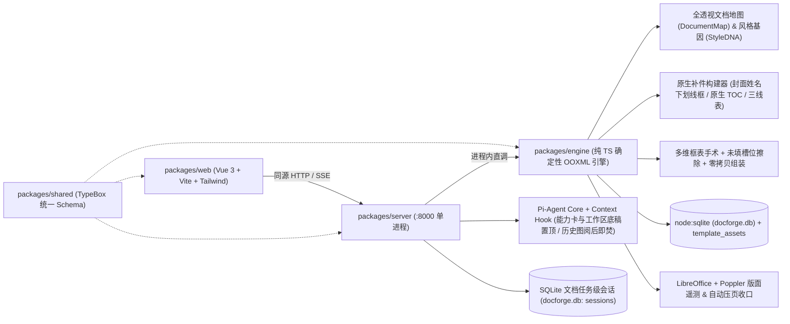

# DocForge V4 · 智能文档格式解剖、无损留壳与自动补件排版系统

DocForge V4 采用**全栈 TypeScript Monorepo（单运行时、单进程、单端口）**架构，面向**高校实验报告 / 课程设计 / 学位论文**、**党政机关与企事业红头公文**、**技术合同协议 / 科研项目申报表**等复杂真实 Word 场景，提供「确定性多维 OOXML 门牌号解剖 + 大模型语义规划 + 内存试填自检 + 原生补件构建器」的通用排版引擎与双模式工作台。

## 核心能力与系统架构

- **页头校徽与媒体 100% 无损保留**：原样保留参考文档中的 `word/header*.xml`、`word/footer*.xml`、`word/media/*`（校徽 Logo、红头图形、公式对象）及样式级联表，并通过分节隔离确保自动生成的首页不串入正文页眉。
- **复杂野生框表与内联多空位精准手术**：统一支持顶层块 `B<i>`、二维合并框表单元格 `B<i>.R<r>.C<c>[.P<p>]`、外层/段内内容控件 `D<d>.P<p>` 与双分支浮动文本框 `B<i>.TX<x>` 寻址；支持同行多下划线宽度守恒填空（`blank`）、跨 Run 预填旧值弹性替换（`match`）、独立格填充（`cell`）及多语义固定栏目路由（`replace` / `insert_after`）。
- **无壳参考件原生自动补件（Builders）**：当参考文档仅有裸正文样式或缺少组件时，自动提取原件字体基因（`StyleDNA`），按需原生生成 ① **首页封面 + 居中隐形网格姓名框与单下边框输入下划线（`w:bottom="single"`）**、② **Word 原生可更新自动目录（`<w:sdt>` `TOC \o "1-3"` + 罗马数字独立页码节）**、③ **同款字体学术三线表**。
- **导入期内存试填转 PDF 自检闭环**：学习任意 `.doc/.docx` 参考件时，自动执行试填组装、OOXML 分节审计与 LibreOffice PDF 渲染校验，发现横幅误伤、框表脱靶或槽位未命中时自动反馈模型自愈。



### Monorepo 模块划分

- `packages/shared`（`@docs-agent/shared`）：前后端、Agent 工具与文档引擎共用的 TypeBox Schema（`StyleDNA`、`DocumentMap`、`Blueprint`、`TemplateAsset`、`ComposePlan`、`LayoutTelemetry`、`SSE` 事件）。
- `packages/engine`（`@docs-agent/engine`）：纯 TypeScript OOXML 引擎（`dom_locator` 多维坐标定位、`doc_inspector` 全透视地图与风格基因提取、`builders` 原生封面/目录/三线表构建器、`composer` 组装执行器、`composition_audit` 独立审计、`layout_telemetry` 版面遥测与自动收口）。
- `packages/server`（`@docs-agent/server`）：单进程统一 HTTP/SSE 服务，提供模板解剖与自检入库、双模式文档组装、Pi-Agent `/chat` 流式工具对话、`/sessions*` 会话分支及 `/` 前端静态托管。
- `packages/web`（`@docs-agent/web`）：Vue 3 + Vite + TypeScript + Tailwind CSS 构建的渐进式披露双模式工作台（普通模式极简套版与 AI 起草，调试模式提供模板资产管理、树状会话、段落区间映射与三标签诊断抽屉）。

## 环境前置与快速启动

### 运行环境要求

- **Node.js** `22.5+`（内置 `node:sqlite`）与 `npm`
- **LibreOffice**（提供 `soffice`，用于 `.doc` 二进制 OLE 自动转换与 PDF 渲染）
- **Poppler 工具链**（提供 `pdftoppm`、`pdftohtml`、`pdfinfo`，用于版面几何遥测与 PNG 预览）

### 安装、构建与启动

```bash
npm install && npm run build
cp .env.example .env  # 若已有 .env 请勿覆盖，按需填入模型配置
./start.sh
```

浏览器访问 `http://localhost:8000` 即开即用（可通过 `PORT=18000 ./start.sh` 指定监听端口）。

## 核心配置说明（`.env`）

| 环境变量 | 说明 |
|---|---|
| `PORT` / `ENGINE_PORT` | 单进程监听端口，默认 `8000` |
| `LLM_BASE_URL` / `LLM_API_KEY` / `LLM_MODEL` | 主对话、模板内化自检与零拷贝规划使用的 OpenAI 兼容模型（如 DeepSeek） |
| `LLM_INPUT_USD_PER_MILLION` / `LLM_OUTPUT_USD_PER_MILLION` | 可选，每百万输入/输出 Token 单价（美元），用于实时账单统计 |
| `LANGFUSE_PUBLIC_KEY` / `LANGFUSE_SECRET_KEY` / `LANGFUSE_BASE_URL` | 可选，Langfuse OpenTelemetry 链路追踪（留空自动使用本地 Pino 日志） |
| `LLM_SUPPORTS_VISION` | 设为 `true` 时使用主模型原生多模态进行关键页视觉终审 |
| `VISION_BASE_URL` / `VISION_API_KEY` / `VISION_MODEL` | 主模型为纯文本模型时，可选配置多模态侧车模型执行视觉终审；未配置时自动以 `text_only` 模式运行 |
| `BENCH_CONCURRENCY` | 评测脚本与语料测试并发度（默认自适应 `min(12, CPU核数-2)`，也可通过 `--concurrency=N` 覆盖） |

## 统一接口与 Agent 工具参考

### 单端口 HTTP / SSE 路由

- **健康与静态资源**：`GET /health`、`GET /`、`GET /assets/*`、`GET /files/*`
- **模板资产接口**：
  - `POST /api/templates/import`（SSE 异步后台导入：解剖样张 + 多轮试填转 PDF 自检并持久化，支持断连取消）
  - `POST /api/templates/inspect`、`POST /api/templates`、`GET /api/templates`、`GET /api/templates/:id`、`GET /api/templates/:id/samples`
  - `PATCH /api/templates/:id`（重命名与修改分类）、`POST /api/templates/:id/fork`、`DELETE /api/templates/:id`
- **草稿、流式组装与版面诊断接口**：
  - `POST /api/drafts/ingest`（导入 `.txt/.docx` 或纯文本草稿并建立 `P0..Pn` 索引）
  - `POST /api/documents/compose-stream`（SSE 一站式套版流）与 `POST /api/documents/compose`（支持 `authored` 与 `exact_copy` 模式、未填槽位自动擦除及 `generate_cover` / `generate_toc` 补件开关）
  - `POST /api/documents/:id/adjust-layout`、`POST /api/documents/:id/visual-audit`
- **Agent 对话与文档任务会话**：`POST /api/chat`（SSE 双向底稿同步与断连中断）、`GET /api/sessions`、`POST /api/sessions`、`PUT /api/sessions/active`、`POST /api/sessions/:id/fork`、`PATCH /api/sessions/:id`、`DELETE /api/sessions/:id`

### Pi-Agent 5 个正交核心工具（`packages/server/src/tools.ts`）

1. `learn_reference_doc`：从本地任意 `.doc/.docx` 参考文档学习风格基因、页头校徽与框表槽位蓝图，自检通过后激活。
2. `manage_templates`：列出、查看详情、切换激活、派生复制或删除模板资产（内置 `builtin-standard-doc` 开箱即用默认模板）。
3. `ingest_draft`：将长草稿切分为本地 `P0..Pn` 段落仓库，供零改字套版映射。
4. `compose_document`：执行元数据填槽、多栏目正文分发、零拷贝套版，以及按需自动生成首页姓名下划线框、原生自动目录与学术三线表。
5. `refine_and_audit`：执行压页收口微调（`compact_pages` 等）或采样关键页执行版面终审。

## 构建、测试与评测命令

```bash
npm run typecheck                                # 全仓 TypeScript 严格类型检查
npm run stylecheck                               # 源码行宽（≤110）与格式规范检查
npm run build                                    # 类型检查 + 打包前端工作台至 packages/web/dist
npm test                                         # 运行全量 Vitest 单元与集成测试（支持 BENCH_CONCURRENCY 并发）
npx tsx packages/server/tests/e2e_verify_v3.ts   # 运行单进程 HTTP + Pi-Agent 真实模型端到端验收
npx tsx eval/run_lab_report_benchmark.ts -c 12   # 运行 30 所高校真实实验报告模板盲测（支持 -c / BENCH_CONCURRENCY）
npx tsx eval/run_benchmark_v3.ts -c 12           # 运行 30 份跨领域语料与长草稿零拷贝评测（支持 -c / BENCH_CONCURRENCY）
```
