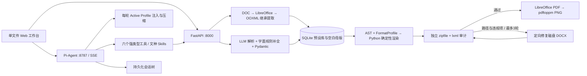

# 基于 Pi-Agent 的智能公文格式 Agent

项目路径：`/home/missi/project/docs-agent/`。

从已有 `.doc/.docx` 或自然语言提取 FormatProfile，保存、继承、微调并设为全局默认；用 DocContentAST 确定性生成 Word，独立解压 OOXML 逐项审计，通过后提供 PNG 预览与下载。支持通知、请示、纪要、函四种按需加载的文种 Skill，以及持久化树状会话分叉。



## 安装与一键启动

依赖 Python 3.11+、Node 22+、npm、LibreOffice 和 Poppler（提供 pdftoppm）。本机实测 Python 3.13.13 / Node 22.23.2 / LibreOffice 24.2.7.2 / pdftoppm 24.02.0。

```bash
cd /home/missi/project/docs-agent
python3 -m venv .venv
.venv/bin/pip install -r engine/requirements.txt
(cd agent && npm ci)
cp .env.example .env  # 已有 .env 时不要覆盖
# 填入 LLM_API_KEY、LLM_BASE_URL、LLM_MODEL
./start.sh
```

打开 **http://localhost:8000**。`Ctrl+C` 停止两个服务；日志在 `data/logs/`。默认端口被占用时脚本明确报错，不会终止其他项目。可以 `ENGINE_PORT=18000 ./start.sh`，访问 http://localhost:18000；Agent 仍为 8787。

无 Key 时可使用导入格式、规则解析、预设管理、直接生成示例与确定性测试；对话需要有效 Key。配置 Key 后以 LLM 解析结果为准，字面规则补充遗漏字段；请求失败会报错，不会冒充成功。`.env` 不提交、不输出密钥。

## 使用

1. 在左侧上传真正的 `.doc/.docx`，或描述格式，例如「标题二号黑体居中；正文三号仿宋_GB2312，行距28磅，首行缩进2字符」。
2. 选择「设为默认」；之后生成与改写自动使用 Active Profile。不传 profile_id 的渲染请求同样遵循该默认。
3. 描述起草需求；Agent 按需加载文种规则，生成 AST 并调用确定性工具。右侧显示 PNG、独立审计分数/字段差异及 Word 下载。
4. 「分叉当前版本」保留父版本的对话与格式；切换分支恢复对应预设和对话。当前工具为单用户、本机会话服务。
5. 修改已有预设时选择父预设并输入增量要求，原预设不会被覆盖。启用红头时需提供机关名或明确落款单位；未提供时渲染器请求补充，不虚构机关。

中文字号表包含初号到小五的全部 12 个规定值。字体 XML 始终分离 eastAsia 中文与 ascii/hAnsi/cs 西文；两端对齐写入 `both`。首行缩进同时写入字符与 twips，独立审计校验二者。

## 接口与工具

FastAPI 的 `/docs` 提供 OpenAPI。规定九个接口完整实现：health；profiles 列表/详情/extract/from-nl/fork/active；documents/render/lint。另有 `POST /api/documents/repair` 和 `DELETE /api/profiles/{id}`。修复接口接收数据目录内的 DOCX 路径、有效预设与本次违规项，返回修复前后审计和通过后的 PNG。

六个 Agent Tools：`import_doc_format`、`parse_nl_format`、`manage_profiles`、`load_doc_skill`、`render_gongwen_docx`、`lint_and_preview_docx`。`agent/src/engine_client.ts` 与 Pydantic 模型对齐。Agent HTTP 提供 `/health`、`/chat`（SSE）、`/sessions`、`/sessions/fork`、`/sessions/switch`。

```bash
curl -X POST http://localhost:8000/api/documents/render \
  -H 'Content-Type: application/json' \
  -d '{"content_ast":{"doc_type":"notice","title":"关于开展培训的通知","blocks":[{"type":"body","text":"请各部门做好培训组织工作。"}],"signature":"综合办公室"}}'
```

## 实测与复现

2026-11-24 使用本机和 `deepseek/deepseek-v4.1-flash` 完成 V2 全量实测。逐项记录见 [评测报告](eval/report.md)、[原始结果](eval/results.json) 和 [验收日志](PROGRESS.md)。

| 项目 | 实测 |
|---|---:|
| 20 份独立合成范本提取 | 2088/2088（100%） |
| 合成范本重渲染独立审计 | 20/20（100%） |
| 锁定真实公文提取、空白母版、渲染、审计与 PNG | 16/16（100%） |
| 30 条唯一指令的 NL 字段断言 | 233/233（100%） |
| 系统修复前及修复后的金标准审计 | 均为 30/30（100%） |
| Baseline 总通过率 | 6/30（20.00%） |
| Baseline 有效响应通过率 | 6/22（27.27%） |
| Baseline 有效响应代码执行失败率 | 2/22（9.09%） |
| 独立故障注入修复前后的文档通过率 | 0/10 → 10/10 |
| Pi-Agent 确定性场景与真实 LLM 对话 | 各 4/4 |

8 条 Baseline 请求在重试后仍网络超时。有效响应通过率使用实际收到模型输出的 22 条为分母。系统与 Baseline 使用相同正文 AST 和目标预设评分。Baseline 直接获得完整目标预设，系统从自然语言和父预设推断格式。故障注入分别从 10 个磁盘 DOCX 的实际违规开始，每份单轮从 17 项降至 0 项。

真实语料以锁定清单为准。魔数实测为 9 份原生 DOCX、6 份二进制 `.doc` 与 1 份后缀为 `.docx` 的二进制 OLE，全部原件通过 SHA256。完整通知的 PNG 可查看两字符缩进、两端对齐与居中的页码。见 [预览样例](data/visual-check-v2/page-1.png)。

```bash
.venv/bin/python -m pytest engine/tests/ -v
(cd agent && npx tsc --noEmit)
.venv/bin/python eval/check_style.py
(cd agent && ENGINE_URL=http://127.0.0.1:18000 npm run verify)
.venv/bin/python eval/build_fixtures.py
.venv/bin/python eval/run_benchmark.py --verify-inputs
.venv/bin/python eval/run_benchmark.py --with-llm
.venv/bin/python eval/run_benchmark.py --reaudit
```

运行 LLM 对比需启用 Linux 用户及网络命名空间和 Landlock ABI 3。Baseline 脚本只可写自己的评测目录，读取 Python 运行库，模型网络请求由主进程发出。两类模型请求的单次超时为 180 秒，对暂时性错误最多指数退避重试三次。`--reaudit` 使用刚完成的 V2 运行产物重新核对审计，无需向模型重复请求。

## 边界

- 本机未安装仿宋_GB2312、方正小标宋简体与 Times New Roman 的对应字体；LibreOffice PNG 使用字体回退。Word 的 OOXML 字体名与审计正确，但预览外观与安装对应字体的 Word 环境有差异。需要精确视觉验收时安装具有合法授权的目标字体。
- 提取依赖可编辑文字和可观测段落格式；扫描件 OCR、复杂浮动文本框及所有任意母版布局不在当前数据集验证范围。正文母版剥离保留节属性和样式，正文文字/表格移除，页眉页脚文本清空。
- 预览是 LibreOffice 的页面渲染，不是 Microsoft Word 像素一致性承诺。GB/T 默认用于缺省补全，自定义预设可以有意偏离国标。
- 指定的 @mariozechner 两包 0.73.1 上游已 deprecated；遵照任务仍使用这些包。basic-ftp 间接依赖已覆盖至 6.2.6，本次 npm audit 为0漏洞。
